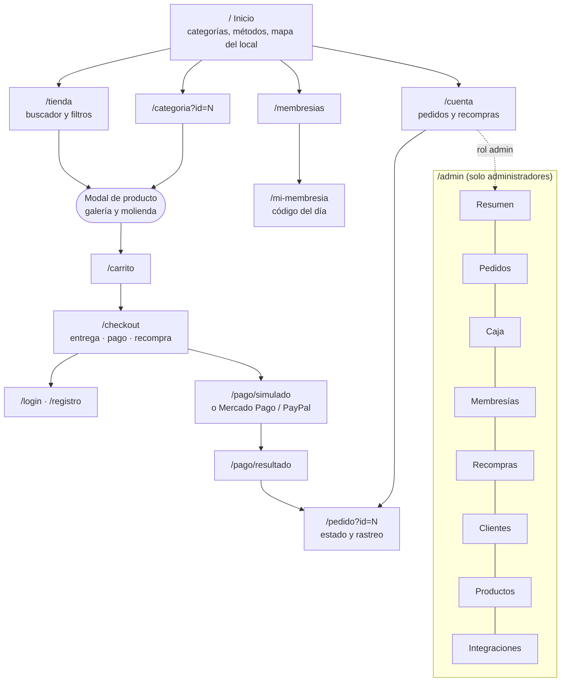
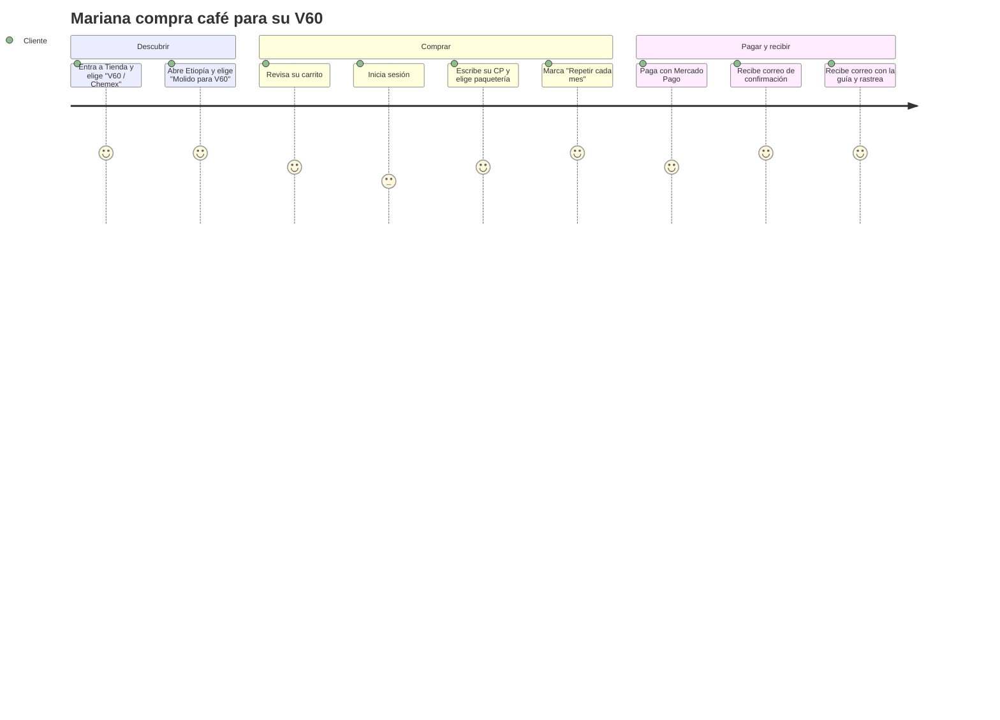
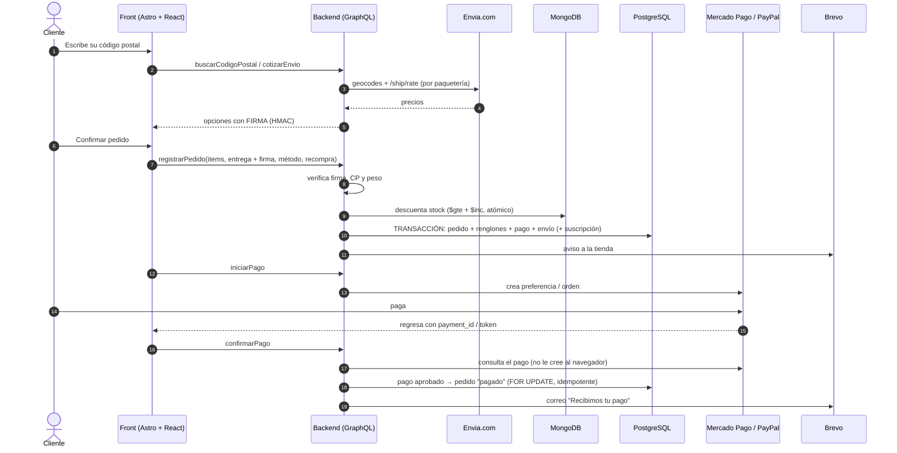
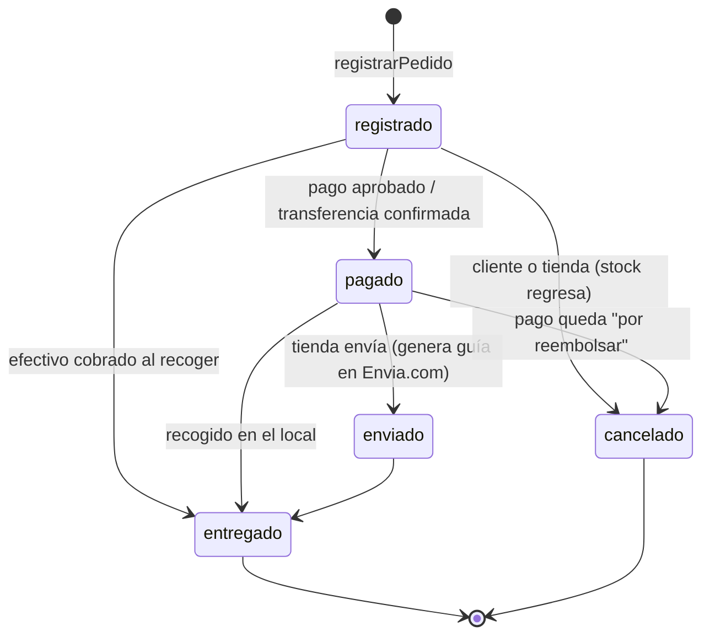
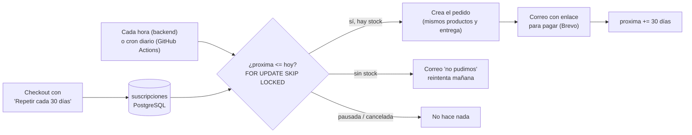
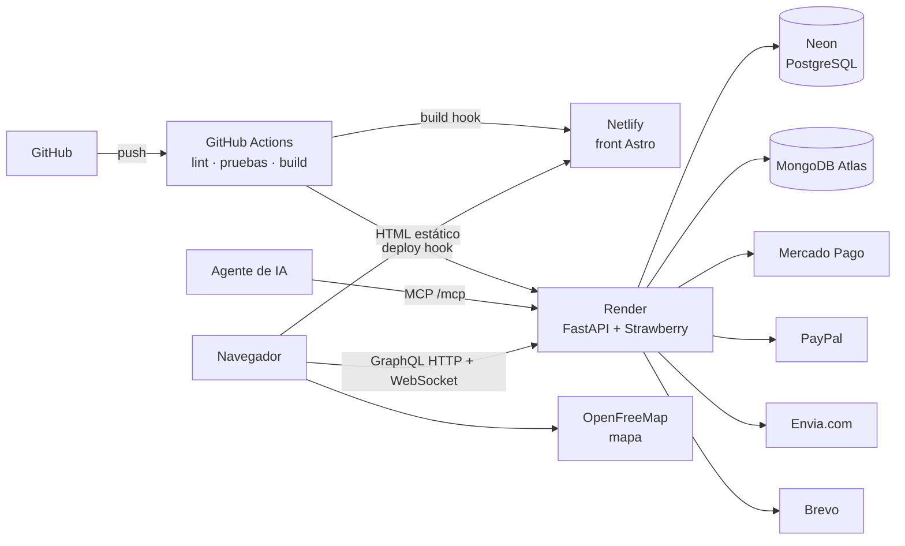
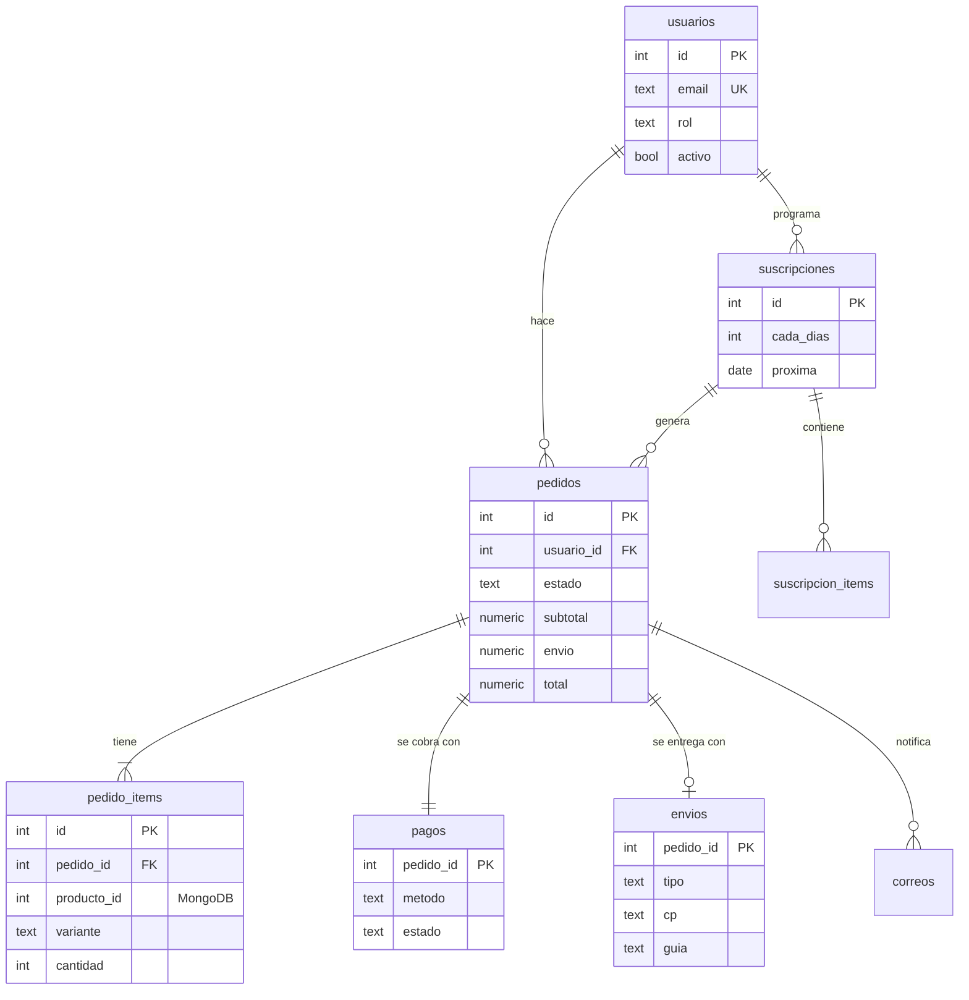

# Mapas del proyecto

Los diagramas están en Mermaid: GitHub los dibuja solos al abrir este archivo.

## 1. Mapa del sitio

## 2. Flujo de navegación de una compra (experiencia del cliente)

## 3. Proceso de compra (sistema)

## 4. Ciclo de vida del pedido

## 5. Proceso de recompra

## 6. Arquitectura y despliegue

## 7. Modelo de datos relacional (PostgreSQL)

El catálogo y las membresías viven en MongoDB (ver `back/database.py`); se unen por id
(`pedido_items.producto_id` → producto, `membresias.usuario_id` → `usuarios.id`).
